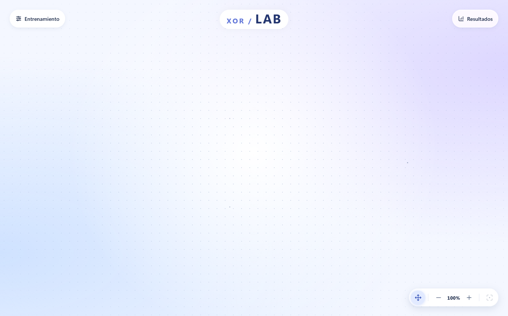

# XOR Lab

<p align="center"></p>

**XOR Lab** muestra cómo una red neuronal pequeña aprende una operación que no puede resolverse con una sola frontera lineal. La red combina dos entradas, dos neuronas ocultas y una salida para aprender la tabla XOR.

## Qué puedes explorar

La interfaz permite observar las entradas y activaciones de la red, entrenar paso a paso o automáticamente, ajustar el aprendizaje y explorar el diagrama con zoom y arrastre. Las cuatro combinaciones de entrada se contrastan con sus predicciones para ver cómo cambia la salida a medida que aprende.

## La lógica

Cada neurona calcula una suma ponderada de sus entradas y aplica la función sigmoide. Las dos activaciones ocultas alimentan la salida. En cada ejemplo, la retropropagación compara la predicción con el valor esperado y ajusta pesos y sesgos para reducir el error cuadrático medio. La sesión conserva los parámetros y el avance del entrenamiento para reflejarlos en la interfaz.

## Abrir XOR Lab

Descarga la versión para Windows y ejecuta el archivo. No requiere instalar Python:

<p align="center"><a href="https://github.com/sebasjq/xor-neural-network/releases/latest/download/XOR-Lab-1.0.0-portable.exe"><strong>⬇ Descargar XOR Lab para Windows</strong></a></p>

También puedes iniciarlo desde el código con Python 3:

```bash
python -m interface.app
```

Abre `http://127.0.0.1:8000` en el navegador.

## Colaboradores

- Simón Tomás Paipa Bravo
- Juan Sebastián Sánchez Quimbaya
