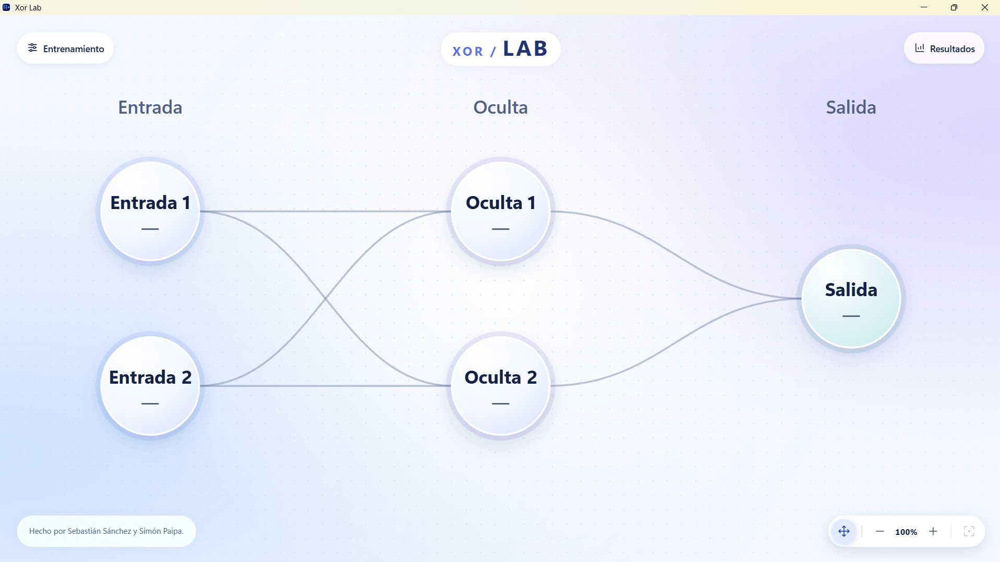
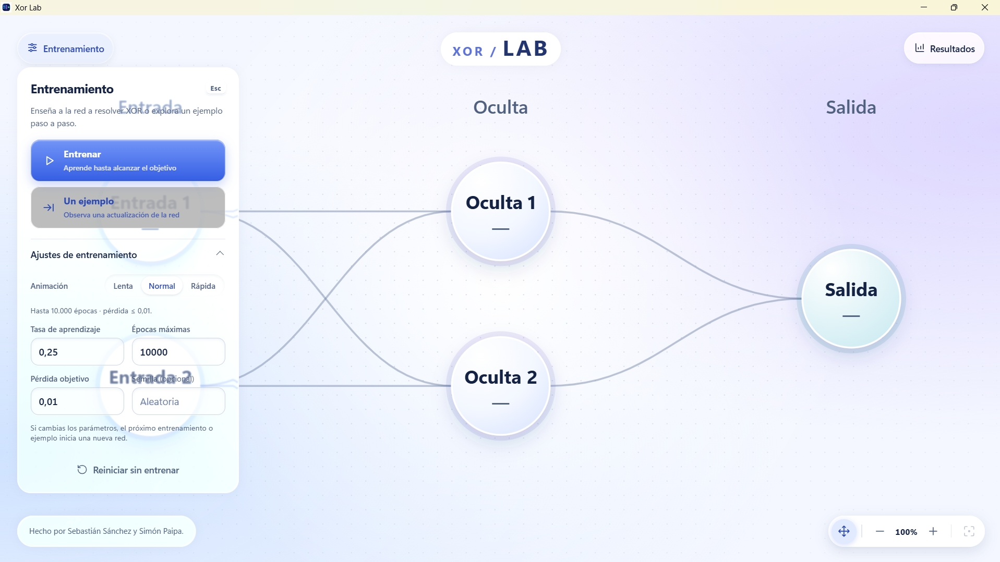
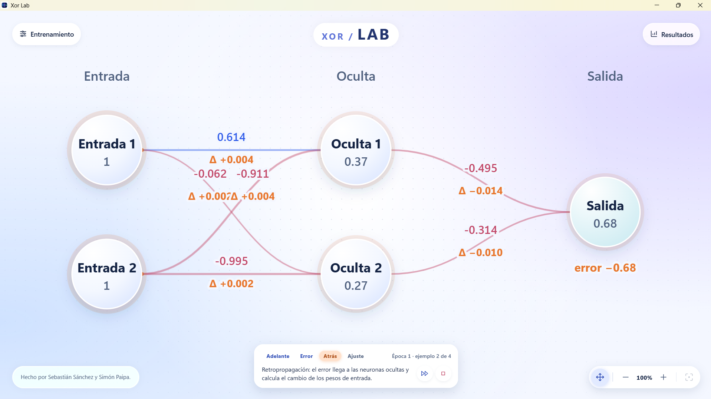
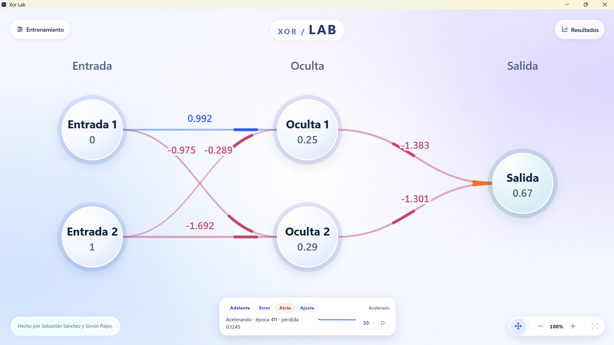
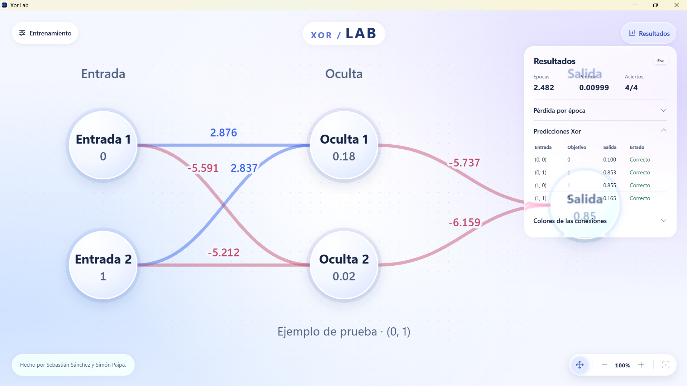

# XOR Lab

Una exploración visual del aprendizaje de una red neuronal. XOR Lab enseña cómo una red con una capa oculta puede aprender la operación XOR, cuyo patrón no se separa con una sola línea.

## Qué ocurre dentro de la red

Dos entradas se conectan con dos neuronas ocultas y una neurona de salida. Cada neurona combina sus entradas con pesos y sesgos y aplica una sigmoide. Durante el entrenamiento, la retropropagación compara la predicción con el resultado esperado y ajusta los parámetros para reducir el error. En la interfaz puedes observar las conexiones y activaciones, avanzar paso a paso o entrenar automáticamente, cambiar el ritmo y comparar las cuatro combinaciones de la tabla XOR.

## Recorrido por XOR Lab

Las capturas siguen el orden de uso, desde la vista inicial hasta la evaluación de la red. Pulsa cualquier imagen para verla en tamaño completo.

### 1. Conocer la red

La vista inicial presenta las dos entradas, las dos neuronas ocultas y la salida. Puedes desplazar el diagrama y ajustar el zoom para explorar sus conexiones.

<p align="center"><a href="docs/01-inicio.png"></a></p>

### 2. Configurar el entrenamiento

En Entrenamiento puedes ajustar la tasa de aprendizaje, las épocas máximas, la pérdida objetivo y una semilla opcional. También puedes elegir la velocidad de animación o explorar un solo ejemplo.

<p align="center"><a href="docs/02-configuracion.png"></a></p>

### 3. Observar cómo aprende

El recorrido animado distingue propagación hacia adelante, cálculo del error, retropropagación y ajuste. Esta captura muestra el error regresando hacia las neuronas ocultas y los cambios calculados para los pesos.

<p align="center"><a href="docs/03-retropropagacion.png"></a></p>

### 4. Seguir el entrenamiento

El modo acelerado permite avanzar por las épocas mientras se actualizan los pesos y la pérdida. La captura muestra una etapa intermedia del aprendizaje; todavía no es el resultado final.

<p align="center"><a href="docs/04-entrenamiento.png"></a></p>

### 5. Revisar los resultados

El panel Resultados resume las épocas, la pérdida y las predicciones de las cuatro combinaciones XOR. En esta ejecución, la red llegó a 4 de 4 aciertos tras 2.482 épocas, con una pérdida de 0,00999. El resultado puede variar según la inicialización y los parámetros.

<p align="center"><a href="docs/05-resultados.png"></a></p>

## Probar XOR Lab

Descarga y ejecuta la aplicación portable para Windows; no requiere instalar Python.

<p align="center"><a href="https://github.com/sebasjq/xor-neural-network/releases/latest/download/XOR-Lab-1.0.0-portable.exe"><strong>⬇ Descargar XOR Lab para Windows</strong></a></p>

También puedes abrir el código con Python 3:

```bash
python -m interface.app
```

Luego visita `http://127.0.0.1:8000`.

## Equipo

- Simón Tomás Paipa Bravo
- Juan Sebastián Sánchez Quimbaya
